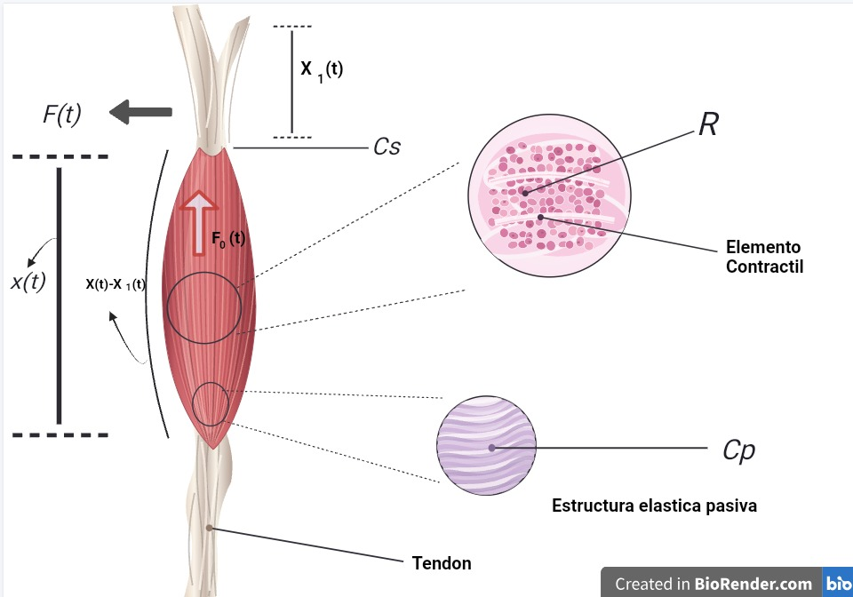
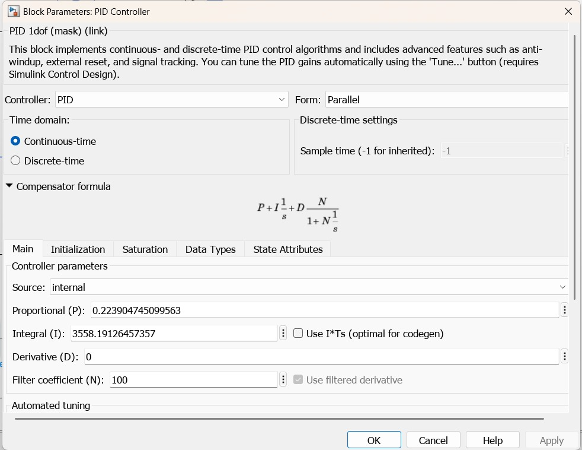
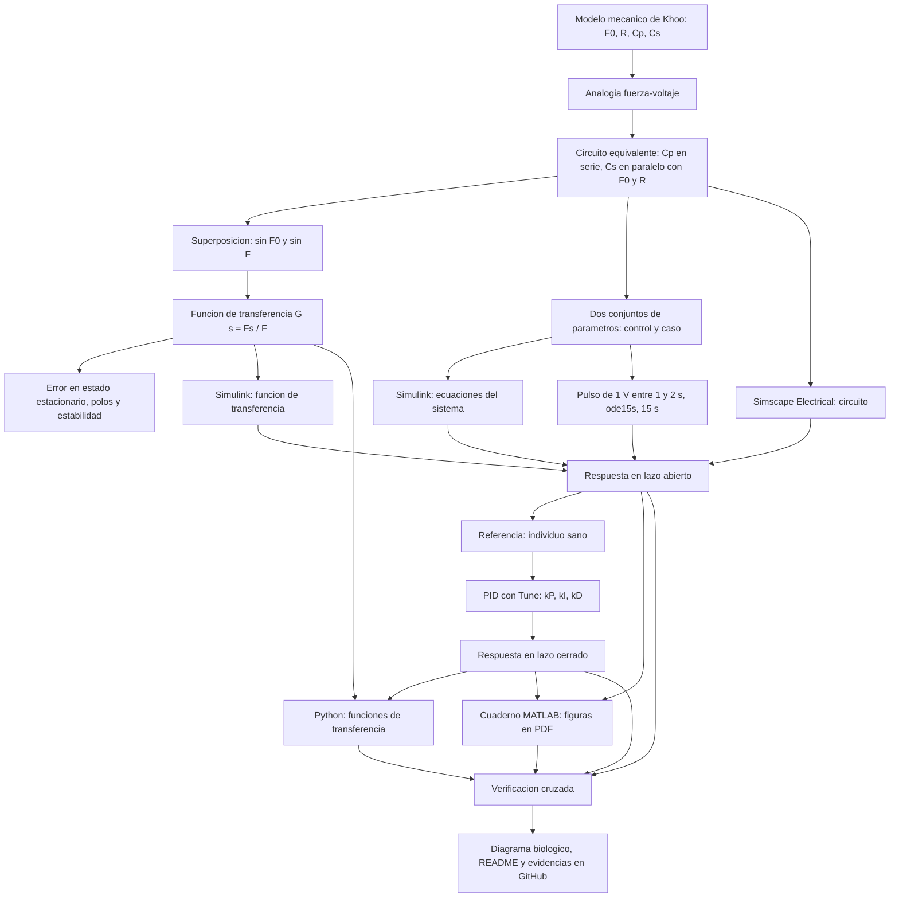

[](https://matlab.mathworks.com/open/github/v1?repo=deltorox-e-ITT/MSFP3)

# Práctica 3 — Modelado y control del sistema musculoesquelético 

**Docente:** Dr. Paul Antonio Valle Trujillo  
**Correo:** paul.valle@tectijuana.edu.mx  
**Departamento:** Ingeniería Eléctrica y Electrónica  
**Institución:** Tecnológico Nacional de México / Instituto Tecnológico de Tijuana  
**Asignatura:** Modelado de Sistemas Fisiológicos  
**Programa:** Ingeniería Biomédica  
**Estudiante:** Eduardo Del Toro Nuñez · C23212399 · LC23212399@tectijuana.edu.mx

**Repositorio de la práctica:** https://github.com/deltorox-e-ITT/MSFP3  
**Repositorio de la asignatura:** https://github.com/DrPaulValle/MSF-IBF1020  
**Sede:** Blvd. Alberto Limón Padilla s/n, Tijuana, C. P. 22454, B. C., México.

Repositorio académico de la asignatura **Modelado de Sistemas Fisiológicos**, correspondiente al programa de **Ingeniería Biomédica** del Tecnológico Nacional de México / Instituto Tecnológico de Tijuana. La práctica integra modelado mecánico, analogías electromecánicas, análisis de estabilidad, diseño de un controlador PID, simulación computacional *in silico* y verificación cruzada entre plataformas.

El caso de estudio representa un **compartimento musculoesquelético** mediante el modelo viscoelástico de Khoo (Figura 5.3 del instructivo): un elemento contráctil activo $F_0(t)=\alpha F(t)$, un amortiguador $R$ y dos elementos elásticos, uno en paralelo ($C_p$) y otro en serie ($C_s$). Mediante la analogía **fuerza → voltaje**, el modelo se estudia como un circuito eléctrico. Se comparan dos condiciones —un **individuo sano** (control) y un **caso simulado de atrofia muscular** (caso)— que difieren **únicamente en la resistencia $R$** ($100\ \Omega$ frente a $10\ \mathrm{k}\Omega$), y se diseña un controlador PID que busca reducir la diferencia entre la respuesta del caso y la del control.


---

<a id="contenido"></a>
## Contenido

1. [Resumen](#resumen)
2. [Competencia y objetivos](#objetivos)
3. [Relación con el temario](#temario)
4. [Sistema fisiológico: el sistema musculoesquelético](#fisiologico)
5. [Modelo físico y analogía eléctrica](#analogia)
6. [Formulación matemática](#modelo)
7. [Implementación en MATLAB, Simulink y Simscape](#matlab)
8. [Control en lazo cerrado y sintonización PID](#pid)
9. [Reproducción en Python](#python)
10. [Diagrama biológico](#biologico)
11. [Resultados y verificación cruzada](#resultados)
12. [Discusión y conclusiones](#discusion)
13. [Flujo de trabajo](#flujo)
14. [Actividades del estudiante](#actividades)
15. [Estructura del repositorio](#estructura)
16. [Requisitos](#requisitos)
17. [Reproducibilidad y entregables](#reproducibilidad)
18. [Referencias](#referencias)

---

<a id="resumen"></a>
## Resumen

La práctica tiene como propósito **modelar, analizar, simular y controlar** la respuesta de fuerza de un compartimento musculoesquelético mediante un modelo viscoelástico simplificado. El modelo mecánico incluye un elemento contráctil activo ($F_0$), un amortiguador viscoso ($R$), un elemento elástico en paralelo ($C_p$) y un elemento elástico en serie ($C_s$). Con la analogía **fuerza → voltaje**, **velocidad → corriente** y **desplazamiento → carga**, el sistema se convierte en un circuito eléctrico en el que los elementos conectados en paralelo en el modelo mecánico quedan en serie en el circuito, y viceversa.

Aplicando el **principio de superposición** (una fuente a la vez: primero sin $F_0(t)$ y luego sin $F(t)$) se obtiene la función de transferencia entre la fuerza aplicada y la fuerza en el elemento $C_p$:

$$
G(s)=\frac{F_s(s)}{F(s)}=\frac{C_sR\,s+1-\alpha}{R\,(C_p+C_s)\,s+1},
$$

un sistema **bipropio de primer orden**. Con los parámetros del instructivo, el control ($R=100\ \Omega$) tiene una constante de tiempo de $11\ \mathrm{ms}$ y el caso ($R=10\ \mathrm{k}\Omega$) de $1.1\ \mathrm{s}$; ambos comparten la misma ganancia estática $1-\alpha=0.75$, de modo que **la atrofia simulada no cambia el valor final, sino la rapidez de la respuesta**.

Posteriormente se construye un sistema de retroalimentación negativa que usa la respuesta del individuo sano como referencia para el caso, con un **controlador PID** sintonizado con la herramienta *Tune* de Simulink ($k_P=0.2239$, $k_I=3558.19$, $k_D=0$). Los resultados se verifican de forma cruzada entre cinco implementaciones: ecuaciones del sistema y función de transferencia en Simulink, circuito en Simscape Electrical, cuaderno de MATLAB y código en Python.

La práctica se desarrolla **exclusivamente mediante experimentación *in silico***. La estrategia de control tiene propósitos **académicos y de simulación** y no constituye una estrategia terapéutica para el tratamiento de la atrofia muscular.


[Volver al contenido](#contenido)

---

<a id="objetivos"></a>
## Competencia y objetivos

### Competencia a desarrollar

Modeliza sistemas fisiológicos mediante analogías entre sistemas físicos, ecuaciones diferenciales y funciones de transferencia para analizar su comportamiento dinámico, y diseña estrategias de control mediante técnicas de control clásico. En particular, el estudiante analiza un modelo mecánico simplificado del sistema musculoesquelético, construye su circuito eléctrico equivalente mediante la analogía fuerza–voltaje, compara la respuesta de un individuo sano (control) con un caso simulado de atrofia muscular (caso) y diseña una estrategia de control *in silico* orientada a reducir las diferencias entre ambas respuestas.

### Objetivo general

Modelar y controlar *in silico* la respuesta de fuerza de un compartimento musculoesquelético mediante un modelo viscoelástico y su circuito eléctrico equivalente, comparando un individuo sano con un caso de atrofia muscular simulada y verificando los resultados mediante diferentes plataformas computacionales.

### Objetivos específicos

- Identificar los elementos $F_0(t)$, $F(t)$, $R$, $C_p$, $C_s$, $x(t)$ y $x_1(t)$ del modelo mecánico y describir su función.
- Convertir el modelo mecánico en un circuito eléctrico equivalente con la analogía fuerza–voltaje, cuidando la topología y los nodos de referencia.
- Formular las ecuaciones del sistema y obtener la función de transferencia mediante la transformada de Laplace y el principio de superposición.
- Determinar la respuesta final y el error en estado estacionario del control y del caso, y analizar el efecto de modificar $R$.
- Calcular los polos, representarlos en el plano complejo y determinar la estabilidad de ambos modelos.
- Implementar los modelos mediante ecuaciones del sistema, función de transferencia y circuito equivalente (Simscape Electrical) en Simulink.
- Simular control y caso en lazo abierto y comparar sus características temporales.
- Construir el sistema de control con retroalimentación negativa y sintonizar un PID para el caso.
- Analizar el efecto del controlador sobre la amplitud, la velocidad de respuesta, el amortiguamiento y la diferencia entre caso y control.
- Reproducir los resultados en MATLAB (cuaderno) y Python, y verificarlos de forma cruzada.
- Elaborar un diagrama biológico que relacione el modelo con las estructuras fisiológicas.
- Documentar la práctica en un repositorio de GitHub.

[Volver al contenido](#contenido)

---

<a id="temario"></a>
## Relación con el temario

La práctica integra contenidos de la asignatura **Modelado de Sistemas Fisiológicos (IBF-1020)**:

| Unidad | Área | Contenidos aplicados |
|---|---|---|
| I | Sistemas de control retroalimentados | Diagramas de bloques, retroalimentación negativa, señal de error, respuesta temporal y criterios de estabilidad |
| II | Modelado matemático | Analogía electromecánica fuerza–voltaje, leyes de los circuitos, superposición y funciones de transferencia |
| III | Controladores | Controlador PID, sintonización de ganancias y análisis del desempeño en lazo cerrado |

El enfoque combina **Ingeniería de Control, Electrónica Analógica, Ciencias de la Computación y Fisiología**.

[Volver al contenido](#contenido)

---

<a id="fisiologico"></a>
## Sistema fisiológico: el sistema musculoesquelético

Esta sección corresponde a la práctica **5.5 del instructivo** (*Modelado y control del sistema musculoesquelético*) y describe el sistema fisiológico que se modela antes de pasar a su representación mecánica y eléctrica.

### Descripción general

El **sistema musculoesquelético** está formado por huesos, articulaciones, músculos esqueléticos, tendones y tejido conectivo asociado. Sus funciones principales son generar fuerza y movimiento, sostener el cuerpo y transmitir cargas al esqueleto. El **músculo esquelético** transforma la activación neural en fuerza mecánica, y el **tendón** transmite esa fuerza al hueso, de modo que la fuerza que finalmente se aprovecha no es solo la que generan las fibras musculares, sino el resultado de las propiedades mecánicas de todos los tejidos involucrados.

Esas propiedades son **viscoelásticas**: el tejido se deforma de forma elástica (recupera su longitud al retirar la carga) y, a la vez, opone una resistencia que depende de la velocidad de deformación (comportamiento viscoso). Por eso un compartimento musculoesquelético puede representarse, de forma simplificada, con una combinación de un elemento contráctil, resortes y un amortiguador, como propone Khoo [1].

### Estructuras fisiológicas y elementos del modelo

| Estructura fisiológica | Función | Elemento del modelo |
|---|---|---|
| **Fibras musculares y sarcómeros** (filamentos de actina y miosina) | Generan fuerza activa mediante la formación de puentes cruzados cuando el músculo es activado | Elemento contráctil: fuerza $F_0(t)=\alpha F(t)$ |
| **Comportamiento viscoso del tejido** (fricción interna entre filamentos, líquidos y tejido conectivo) | Opone resistencia al movimiento en función de la velocidad de deformación | Amortiguador $R$ |
| **Estructuras elásticas pasivas** (sarcolema y tejido conectivo del músculo) | Resisten el estiramiento y almacenan energía elástica, incluso sin activación | Elemento elástico **en paralelo** $C_p$, con desplazamiento $x(t)$ |
| **Tendón** | Transmite la fuerza del músculo al hueso y se estira de forma elástica | Elemento elástico **en serie** $C_s$, con desplazamiento $x_1(t)$ |

La asociación entre estructuras y elementos es **simplificada**, como indica el instructivo: cada elemento concentra el efecto de varias estructuras reales.

### Atrofia muscular y caso simulado

La **atrofia muscular** es la disminución de la masa y de la capacidad de generar fuerza del músculo. En esta práctica se representa de forma deliberadamente simple: el caso simulado conserva todos los parámetros del individuo sano y solo cambia la resistencia $R$ ($100\ \Omega \rightarrow 10\ \mathrm{k}\Omega$), lo que equivale a mayor amortiguación viscosa y a una respuesta de fuerza más lenta. El modelo **no** representa la pérdida de fuerza activa ni los cambios en la elasticidad que acompañan a la atrofia real (ver *Limitaciones* en la discusión).

### Diagrama biológico y su relación con el circuito

La siguiente figura, elaborada en BioRender, ubica sobre el músculo y el tendón los elementos del modelo mecánico y del circuito equivalente: la fuerza transmitida $F(t)$, la fuerza del elemento contráctil $F_0(t)$, la resistencia $R$ (asociada al elemento contráctil ampliado), la estructura elástica pasiva $C_p$, el elemento en serie $C_s$ (tendón) y los desplazamientos $x(t)$, $x_1(t)$ y $x(t)-x_1(t)$.



*Figura 1. Diagrama biológico del sistema musculoesquelético (elaborado en BioRender) y su relación con los elementos del modelo mecánico y del circuito eléctrico equivalente.*

| Etiqueta en la figura | Qué representa | Equivalente en el circuito |
|---|---|---|
| $F(t)$ | Fuerza transmitida por el sistema | Fuente de voltaje de entrada $F(t)$ |
| $F_0(t)$ | Fuerza generada por el elemento contráctil | Fuente de voltaje $F_0(t)=\alpha F(t)$ |
| $R$ (*Elemento Contráctil*) | Amortiguación viscosa asociada al tejido contráctil | Resistencia $R$ |
| $C_p$ (*Estructura elástica pasiva*) | Elasticidad en paralelo: sarcolema y estructuras pasivas | Capacitor $C_p$, en serie en el circuito |
| $C_s$ y *Tendón* | Elasticidad en serie | Capacitor $C_s$, en paralelo con la rama $F_0$–$R$ |
| $x(t)$ | Desplazamiento del elemento paralelo | Carga de $C_p$ |
| $x_1(t)$ | Desplazamiento del elemento en serie | Carga de $C_s$ |
| $x(t)-x_1(t)$ | Deformación del amortiguador | Carga asociada a $R$ (su derivada es la corriente) |

El análisis mecánico y la construcción del circuito se desarrollan en la siguiente sección.

[Volver al contenido](#contenido)

---

<a id="analogia"></a>
## Modelo físico y analogía eléctrica

### Modelo mecánico

El modelo mecánico (Figura 5.3 del instructivo, basado en Khoo) representa de forma simplificada la relación entre la fuerza desarrollada por el músculo, su deformación y las propiedades mecánicas de los tejidos y tendones:

- $F_0(t)$ es la fuerza desarrollada por el **elemento contráctil activo**, y $F(t)$ es la fuerza transmitida por el sistema después de considerar sus propiedades mecánicas. Se cumple $F_0(t)=\alpha F(t)$, con $0<\alpha<1$.
- $R$ es la **amortiguación viscosa** inherente al tejido.
- $C_p$ y $C_s$ son las propiedades elásticas del elemento **paralelo** y del elemento **en serie**, asociadas de forma simplificada con el sarcolema, las estructuras musculares pasivas y los tendones.
- Si $C_p$ presenta un desplazamiento $x(t)$ y $C_s$ un desplazamiento $x_1(t)$, la deformación del amortiguador es $x(t)-x_1(t)$ y su velocidad relativa es $\dfrac{d}{dt}[x(t)-x_1(t)]$.

### Analogía fuerza–voltaje

| Sistema mecánico | Sistema eléctrico equivalente |
|---|---|
| Fuerza $F(t)$ | Voltaje $V(t)$ |
| Velocidad $\dot{x}(t)$ | Corriente $I(t)$ |
| Desplazamiento $x(t)$ | Carga eléctrica $q(t)$ |
| Amortiguador | Resistencia $R$ |
| Compliancia mecánica | Capacitancia $C$ |
| Masa | Inductancia $L$ (no hay masas en este modelo) |

Una consecuencia de la analogía es que **las topologías no se conservan**: los componentes mecánicos en paralelo pasan a elementos eléctricos en **serie**, y los componentes mecánicos en serie pasan a elementos eléctricos en **paralelo**. Por eso, en el circuito, $C_p$ (paralelo mecánico) queda **en serie** con el resto, y $C_s$ (serie mecánico) queda **en paralelo** con la rama formada por $F_0$ y $R$.

### Topología del circuito

```text
   ┌──────────────────────┬──────────────┐
   │                      │              │
 F(t)                   F0(t)           Cs      ↓ I1
 (±)                    (±)  ↓ I2        │
   │                      │              │
   │                      R              │
   │                      │              │
   │                      └──────┬───────┘
   │                             ● Fs(t)
   │                             │
   │                            ═╧═ Cp
   │                            ═╤═
   │                             │
   └─────────────────────────────┘

   I(t) = I1(t) + I2(t) = corriente total (velocidad ẋ)
```

El desarrollo manuscrito del circuito y de la superposición se encuentra en [`AnalisisMatematico.pdf`](AnalisisMatematico.pdf).

### Variables y parámetros

| Símbolo | Equivalente eléctrico | Interpretación fisiológica |
|---|---|---|
| $F(t)$ | Fuente de voltaje de entrada | Fuerza transmitida por el sistema |
| $F_0(t)=\alpha F(t)$ | Fuente de voltaje en serie con $R$ | Fuerza del elemento contráctil activo |
| $F_s(t)$ | Voltaje en $C_p$ (salida) | Fuerza en el elemento elástico paralelo |
| $R$ | Resistencia | Amortiguación viscosa del tejido |
| $C_p$ | Capacitancia (en serie en el circuito) | Elasticidad del elemento paralelo: sarcolema y estructuras pasivas |
| $C_s$ | Capacitancia (en paralelo con $F_0$–$R$) | Elasticidad del elemento en serie: tendón |
| $I(t)=\dot{x}(t)$ | Corriente total | Velocidad de deformación |
| $x(t)$, $x_1(t)$ | Cargas en $C_p$ y $C_s$ | Desplazamientos del elemento paralelo y del elemento en serie |

### Conjuntos de parámetros

| Parámetro | Control (sano) | Caso (atrofia simulada) | Unidades |
|---|---:|---:|---|
| $F(t)$ | $1$ | $1$ | $\mathrm{V}$ |
| $\alpha$ | $0.25$ | $0.25$ | — |
| $C_s$ | $10$ | $10$ | $\mu\mathrm{F}$ |
| $C_p$ | $100$ | $100$ | $\mu\mathrm{F}$ |
| $R$ | $100$ | $10\,000$ | $\Omega$ |

Los dos conjuntos difieren **solo en la resistencia $R$**, que modifica la componente viscosa del modelo. Un aumento de $R$ representa mayor amortiguación viscosa y produce una respuesta mecánica más lenta.

[Volver al contenido](#contenido)

---

<a id="modelo"></a>
## Formulación matemática

### 1. Relaciones constitutivas

Para cada elemento se cumplen las relaciones del modelo mecánico y su equivalente eléctrico:

| Elemento | Relación mecánica | Relación eléctrica |
|---|---|---|
| Resorte (compliancia $C$) | $x=C\,F$ | $q=C\,v$ |
| Amortiguador $R$ | $F=R\,\dot{x}_{\text{rel}}$ | $v=R\,i$ |

Por tanto, el desplazamiento del elemento paralelo es la carga de $C_p$:

$$
x(t)=C_p\,F_s(t).
$$

### 2. Ecuaciones del circuito por superposición

El circuito tiene dos fuentes, $F(t)$ y $F_0(t)=\alpha F(t)$, y se analiza una a la vez.

**Circuito sin $F_0(t)$.** Con $F_{s1}$ como voltaje en $C_p$:

$$
I_1(t)=C_s\frac{d[F(t)-F_{s1}(t)]}{dt},\qquad
I_2(t)=\frac{F(t)-F_{s1}(t)}{R},\qquad
I(t)=I_1+I_2=C_p\frac{dF_{s1}(t)}{dt}.
$$

Aplicando Laplace con condiciones iniciales nulas:

$$
C_p s F_{s1}(s)=C_s s\,[F(s)-F_{s1}(s)]+\frac{F(s)-F_{s1}(s)}{R}
\;\Longrightarrow\;
\boxed{F_{s1}(s)=\frac{C_sRs+1}{R(C_p+C_s)s+1}\,F(s)}\quad\text{(Salida 1)}
$$

**Circuito sin $F(t)$.** Con la fuente $F(t)$ cortocircuitada, $C_p$ y $C_s$ quedan en paralelo ($C_p+C_s$) y la fuente $-F_0(t)=-\alpha F(t)$ en serie con $R$:

$$
-\alpha F(t)=R\,I(t)+\frac{1}{C_s+C_p}\int I(t)\,dt,\qquad
F_{s2}(t)=\frac{1}{C_s+C_p}\int I(t)\,dt.
$$

Con Laplace:

$$
-\alpha F(s)=R\,I(s)+\frac{I(s)}{(C_p+C_s)s},\qquad
\boxed{F_{s2}(s)=-\frac{\alpha\,F(s)}{R(C_p+C_s)s+1}}\quad\text{(Salida 2)}
$$

**Superposición.** La salida final es la suma de ambas contribuciones:

$$
F_s(s)=F_{s1}(s)+F_{s2}(s)=\frac{C_sRs+1-\alpha}{R(C_p+C_s)s+1}\,F(s).
$$

### 3. Función de transferencia y ecuación diferencial

$$
\boxed{G(s)=\frac{F_s(s)}{F(s)}=\frac{C_sR\,s+(1-\alpha)}{R\,(C_p+C_s)\,s+1}}
$$

Equivale a la ecuación diferencial de primer orden

$$
R(C_p+C_s)\frac{dF_s(t)}{dt}+F_s(t)=C_sR\frac{dF(t)}{dt}+(1-\alpha)F(t).
$$

Se definen los parámetros del sistema:

| Parámetro | Expresión | Significado |
|---|---|---|
| Constante de tiempo | $\tau=R(C_p+C_s)$ | Rapidez de la respuesta |
| Ganancia estática | $K=G(0)=1-\alpha$ | Valor final ante una entrada constante unitaria |
| Salto inicial | $d=\displaystyle\lim_{s\to\infty}G(s)=\frac{C_s}{C_p+C_s}$ | División capacitiva inmediata de la entrada |
| Cero | $s=-\dfrac{1-\alpha}{C_sR}$ | Adelanto del numerador |

El sistema es de **primer orden** (un solo polo) aunque tenga dos capacitores: $C_p$, $C_s$ y la fuente $F(t)$ forman un lazo de capacitores y fuente de voltaje, de modo que solo existe **un estado independiente**. El numerador y el denominador tienen el mismo grado, por lo que $G(s)$ es **bipropia** y presenta el salto inicial $d$ ante una entrada escalón.

### 4. Salida en desplazamiento

Como el instructivo define $G(s)=X(s)/F(s)$ cuando la salida es el desplazamiento, y $x=C_pF_s$:

$$
\frac{X(s)}{F(s)}=C_p\,G(s)=C_p\,\frac{C_sR\,s+1-\alpha}{R(C_p+C_s)s+1}.
$$

Es la misma respuesta que $F_s(t)$, escalada por $C_p=100\ \mu\mathrm{F}$. Este trabajo grafica $F_s(t)$ en voltios.

### 5. Funciones de transferencia de control y caso

Con $\alpha=0.25$, $C_s=10\ \mu\mathrm{F}$, $C_p=100\ \mu\mathrm{F}$:

| Condición | $R$ | $G(s)$ (forma polinómica) | $G(s)$ (forma mónica) |
|---|---:|---|---|
| Control | $100\ \Omega$ | $\dfrac{0.001\,s+0.75}{0.011\,s+1}$ | $\dfrac{0.0909\,s+68.18}{s+90.91}$ |
| Caso | $10\ \mathrm{k}\Omega$ | $\dfrac{0.1\,s+0.75}{1.1\,s+1}$ | $\dfrac{0.0909\,s+0.6818}{s+0.9091}$ |

[Volver al contenido](#contenido)

---

<a id="matlab"></a>
## Implementación en MATLAB, Simulink y Simscape

Para las dos condiciones (control y caso) se construyen tres representaciones equivalentes dentro del modelo de Simulink [`system.slx`](system.slx):

| Implementación | Descripción | Aspecto por verificar |
|---|---|---|
| Ecuaciones del sistema, Simulink | Bloques que implementan las ecuaciones obtenidas por superposición | Consistencia con las ecuaciones del circuito |
| Función de transferencia (**FT**), Simulink | Bloque *Transfer Fcn* con $G(s)$ de cada condición | Respuesta de primer orden bipropia |
| Circuito equivalente (**CE**), Simscape Electrical | Componentes $R$, $C_s$, $C_p$ y las fuentes $F$, $F_0$ conectados según el circuito | Concordancia con las representaciones matemáticas |

Los subsistemas **Control** y **Caso** del modelo entregan las salidas `F(t): Control CE`, `F(t): Control FT`, `F(t): Caso CE`, `F(t): Caso FT` y `PID(t): Caso`, que se comparan en osciloscopios (*Scope: Control* y *Scope: Caso*). Las capturas de ambos osciloscopios están en [`Scope_Control.pdf`](Scope_Control.pdf) y [`Scope_Caso.pdf`](Scope_Caso.pdf).


### Ejecución desde el cuaderno MATLAB

El cuaderno computacional [`DelToroC23212399.mlx`](DelToroC23212399.mlx) ejecuta el modelo y envía al *Workspace* las señales mediante bloques *To Workspace*:

| Variable | Contenido |
|---|---|
| `x.t` | Tiempo de simulación |
| `x.F` | Señal de entrada $F(t)$ |
| `x.Fs1` | Respuesta del **control** |
| `x.FsC` | Respuesta del **caso** en lazo abierto |
| `x.PID` | Respuesta del **caso con controlador** |

La función `plotsignals`:

1. representa gráficamente $F(t)$, el control, el caso y el sistema controlado;
2. identifica las variables y sus unidades ($F(t)$ en $\mathrm{V}$, $t$ en $\mathrm{s}$);
3. compara control, caso y sistema controlado con la leyenda $F(t)$, $F_s(t):Control$, $F_s(t):Caso$ y $PID(t):Tratamiento$; y
4. guarda la figura en formato PDF ([`Respuestasmatlab.pdf`](Respuestasmatlab.pdf)).

La exportación del cuaderno se incluye en [`EDOsysmatlab.pdf`](EDOsysmatlab.pdf).

[Volver al contenido](#contenido)

---

<a id="pid"></a>
## Control en lazo cerrado y sintonización PID

### 1. Esquema de control

La respuesta del **individuo sano** se utiliza como **referencia** para el **caso** (Figura 5.4 del instructivo): la misma señal $V_e(t)$ excita al modelo del control y al modelo del caso; la señal de error entre la referencia y la salida del caso es procesada por un PID que actúa sobre el sistema del caso (paciente/tratamiento), con retroalimentación negativa:

$$
e(t)=x_{\text{control}}(t)-x_{\text{caso}}(t)\;\propto\;F_{s,\text{control}}(t)-F_{s,\text{caso}}(t),
$$

donde la proporcionalidad es $x=C_pF_s$. La ley de control y su forma en Laplace son

$$
u(t)=k_Pe(t)+k_I\int_0^t e(\tau)\,d\tau+k_D\frac{de(t)}{dt},
\qquad
K(s)=k_P+\frac{k_I}{s}+k_Ds.
$$

Con $G_{\text{caso}}(s)$ como planta y la respuesta del control como referencia, la función de transferencia de lazo cerrado es

$$
T(s)=\frac{K(s)\,G_{\text{caso}}(s)}{1+K(s)\,G_{\text{caso}}(s)},
\qquad
F_{s,\text{PID}}(s)=T(s)\,F_{s,\text{control}}(s).
$$

### 2. Sintonización

El controlador se sintoniza con la herramienta **Tune** del bloque *PID Controller* de Simulink, buscando una respuesta **estable** y una **reducción del error** entre el caso y la respuesta del individuo sano.

| Controlador | $k_P$ | $k_I$ | $k_D$ | Otros ajustes |
|---|---:|---:|---:|---|
| PID del caso | $0.223904745099563$ | $3558.19126457357$ | $0$ | Forma paralela, tiempo continuo, filtro derivativo $N=100$ (sin efecto, pues $k_D=0$) |

Con $k_D=0$ el controlador es un **PI**: $K(s)=k_P+k_I/s=\dfrac{k_Ps+k_I}{s}$, con un cero en $s=-k_I/k_P\approx-15\,891\ \mathrm{s^{-1}}$.



*Figura 2. Parámetros del bloque PID Controller obtenidos con la herramienta Tune de Simulink.*

### 3. Función de transferencia en lazo cerrado

Con la planta del caso y las ganancias anteriores:

$$
T(s)=\frac{0.02239\,s^2+355.99\,s+2668.6}{1.1224\,s^2+356.99\,s+2668.6}.
$$

Sus polos son $s=-7.660$ y $s=-310.40\ \mathrm{s^{-1}}$ (reales y negativos, por lo que el lazo cerrado es **estable**), y $T(0)=1$: el integrador hace que el error en estado estacionario ante una referencia constante sea cero.

Como el instructivo indica, no es necesario reproducir valores de referencia exactos: lo importante es justificar el criterio y demostrar que el controlador es estable y reduce el error.

[Volver al contenido](#contenido)

---

<a id="python"></a>
## Reproducción en Python

Como verificación independiente, se implementan en Python (Visual Studio Code) las funciones de transferencia del control y del caso con la biblioteca `control`. El código [`DelToro23212399.py`](DelToro23212399.py):

1. define el pulso de $1\ \mathrm{V}$ entre $t=1$ s y $t=2$ s con las mismas condiciones de simulación;
2. obtiene las respuestas del control y del caso en lazo abierto;
3. incorpora las ganancias $k_P$ y $k_I$ obtenidas con *Tune* ($k_D=0$);
4. construye el sistema del caso en lazo cerrado con la respuesta del control como referencia;
5. imprime las funciones de transferencia, los polos, los valores derivados y una tabla de verificación; y
6. genera la figura y la guarda como [`Respuestas_python.pdf`](Respuestas_python.pdf).

Resultados que imprime el código (comparados con el cálculo analítico y con la lectura aproximada de la gráfica de MATLAB):

| Magnitud | Analítico (V) | Simulado en Python (V) | Gráfica MATLAB (aprox.) (V) |
|---|---:|---:|---:|
| Control en régimen ($t=1.5$ s) | $0.750$ | $0.750$ | $0.75$ |
| Caso justo después de $t=1$ s | $0.091$ | $0.092$ | $\approx 0.1$ |
| Caso en $t=2$ s (antes de bajar el pulso) | $0.484$ | $0.484$ | $\approx 0.5$ |
| Caso justo después de $t=2$ s | $0.394$ | $0.393$ | $\approx 0.4$ |
| PID: pico máximo | — | $0.759$ (en $t=1.077$ s) | $\approx 0.76$ |
| PID: mínimo después de $t=2$ s | — | $-0.009$ (en $t=2.077$ s) | $\approx -0.01$ |

Las diferencias frente a la gráfica de MATLAB corresponden a la lectura visual aproximada, no al modelo.

Dependencias: `numpy`, `control` y `matplotlib` (`pip install numpy control matplotlib`).

[Volver al contenido](#contenido)

---

<a id="biologico"></a>
## Diagrama biológico

Se elabora con BioRender un diagrama del sistema musculoesquelético que relaciona los elementos del modelo con las estructuras fisiológicas. El diagrama se presenta en la sección [Sistema fisiológico](#fisiologico) (Figura 1, [`BiorenderP3.jpeg`](BiorenderP3.jpeg)). Identifica como mínimo: elemento contráctil muscular, estructuras elásticas musculares, tendón, desplazamiento, fuerza generada y elementos asociados con el comportamiento viscoso y elástico.

| Elemento del diagrama | Representación en el modelo mecánico | Equivalente eléctrico |
|---|---|---|
| Elemento contráctil (sarcómeros, actina–miosina) | Fuerza activa $F_0(t)=\alpha F(t)$ | Fuente de voltaje $F_0(t)$ |
| Comportamiento viscoso del tejido | Amortiguador $R$ | Resistencia $R$ |
| Estructuras elásticas musculares (sarcolema, estructuras pasivas) | Elemento elástico **en paralelo** $C_p$, con desplazamiento $x(t)$ | Capacitor $C_p$, **en serie** en el circuito |
| Tendón | Elemento elástico **en serie** $C_s$, con desplazamiento $x_1(t)$ | Capacitor $C_s$, **en paralelo** con la rama $F_0$–$R$ |
| Desplazamiento | $x(t)$, $x_1(t)$ y deformación del amortiguador $x(t)-x_1(t)$ | Cargas $q(t)$ de los capacitores |
| Fuerza generada y transmitida | $F_0(t)$ y $F(t)$ | Voltajes $F_0(t)$ y $F(t)$ |

[Volver al contenido](#contenido)

---

<a id="resultados"></a>
## Resultados y verificación cruzada

### 1. Respuesta en lazo abierto

Se aplica la misma entrada (pulso de $1\ \mathrm{V}$ entre $t=1$ s y $t=2$ s) al control y al caso, y se registra $F_s(t)$.

**Observaciones.**

- El **control** sube prácticamente de golpe a $0.75\ \mathrm{V}$ (con $\tau=11\ \mathrm{ms}$) y regresa a cero al terminar el pulso.
- El **caso** responde con un salto inicial de $0.09\ \mathrm{V}$ y luego sube de forma exponencial; al terminar el pulso solo ha alcanzado $0.484\ \mathrm{V}$ y decae con $\tau=1.1\ \mathrm{s}$, tardando más de $4\ \mathrm{s}$ en regresar a valores cercanos a cero.
- La diferencia máxima entre el caso y el control es de $0.62\ \mathrm{V}$.
- Estas observaciones coinciden con lo esperado del análisis previo: **mismo valor final ($1-\alpha$) y distinta dinámica**, por el aumento de $R$.

### 2. Respuesta en lazo cerrado

Se comparan $F_{s,\text{control}}(t)$, $F_{s,\text{caso}}(t)$ y $F_{s,\text{PID}}(t)$.

- La salida con PID **sigue a la referencia** del control: entra a la banda de $\pm2\ \%$ de $0.75\ \mathrm{V}$ unos $24\ \mathrm{ms}$ después del inicio del pulso y permanece dentro de ella hasta que termina.
- Presenta un **sobreimpulso pequeño** ($0.759\ \mathrm{V}$ en $t=1.077$ s) y un **subimpulso** de $-0.009\ \mathrm{V}$ en $t=2.077$ s al terminar el pulso, tras lo cual regresa a cero.
- La diferencia máxima respecto del control baja de $0.62\ \mathrm{V}$ (lazo abierto) a $0.13\ \mathrm{V}$, y ocurre en los instantes de transición del pulso.

### 3. Métricas del error

Raíz del error cuadrático medio entre la referencia y la salida, $\mathrm{RMSE}=\sqrt{\frac{1}{T}\int_0^T e^2(t)\,dt}$, calculada en $t\in[0,10]\ \mathrm{s}$ con la simulación de Python:

| Caso | RMSE lazo abierto (V) | RMSE lazo cerrado (V) | Reducción |
|---|---:|---:|---:|
| Atrofia simulada | $0.166$ | $0.006$ | $\approx 96\ \%$ |

### 4. Verificación cruzada entre plataformas

Se comparan las respuestas obtenidas con (a) las ecuaciones del sistema en Simulink, (b) la función de transferencia en Simulink, (c) el circuito en Simscape Electrical, (d) el cuaderno de MATLAB y (e) el código de Python.

| Condición | Ecuaciones (Simulink) | Función de transferencia (Simulink) | Simscape (CE) | Cuaderno MATLAB | Python | ¿Consistentes? |
|---|:---:|:---:|:---:|:---:|:---:|:---:|
| Control | **[COMPLETAR]** | **[COMPLETAR]** | **[COMPLETAR]** | Sí | Sí | **[COMPLETAR]** |
| Caso | **[COMPLETAR]** | **[COMPLETAR]** | **[COMPLETAR]** | Sí | Sí | **[COMPLETAR]** |
| Caso con PID | **[COMPLETAR]** | **[COMPLETAR]** | **[COMPLETAR]** | Sí | Sí | **[COMPLETAR]** |

Las diferencias que aparezcan pueden asociarse con el método numérico (*solver*), el paso máximo de integración o la implementación de los modelos.

### Archivos de resultados

| Resultado | MATLAB/Simulink | Python |
|---|---|---|
| Control, caso y caso con PID | [`Respuestasmatlab.pdf`](Respuestasmatlab.pdf) | [`Respuestas_python.pdf`](Respuestas_python.pdf) |
| Osciloscopio del control (CE y FT) | [`Scope_Control.pdf`](Scope_Control.pdf) | — |
| Osciloscopio del caso (CE, FT y PID) | [`Scope_Caso.pdf`](Scope_Caso.pdf) | — |

[Volver al contenido](#contenido)

---

<a id="discusion"></a>
## Discusión y conclusiones

### Discusión

**Efecto de $R$ en la dinámica.** El análisis muestra que aumentar $R$ de $100\ \Omega$ a $10\ \mathrm{k}\Omega$ no modifica la ganancia estática ($1-\alpha=0.75$) ni el salto inicial ($d=0.0909$), pero desplaza el polo de $-90.9$ a $-0.909\ \mathrm{s^{-1}}$ y aumenta la constante de tiempo de $11\ \mathrm{ms}$ a $1.1\ \mathrm{s}$. En términos del modelo, una mayor amortiguación viscosa produce una respuesta de fuerza más lenta, sin cambiar el valor final.

**Lazo abierto.** La simulación coincide con las predicciones analíticas: el control alcanza $0.75\ \mathrm{V}$ casi de inmediato, mientras que el caso llega a $0.484\ \mathrm{V}$ al terminar el pulso y luego decae lentamente.

**Lazo cerrado.** El PID (en la práctica un PI, pues $k_D=0$) logra que la salida del caso siga la respuesta del control, con un sobreimpulso de $0.009\ \mathrm{V}$ y una reducción del RMSE de $0.166$ a $0.006\ \mathrm{V}$. Las mayores diferencias aparecen en los instantes de transición del pulso. **[COMPLETAR]** Indica si fue necesario ajustar el criterio de sintonización en *Tune* y qué compromisos observaste.

**Verificación entre plataformas.** **[COMPLETAR]** Indica el grado de concordancia entre Simulink, Simscape, MATLAB y Python, y las causas de cualquier discrepancia.

**Limitaciones.** El modelo es lineal, de parámetros concentrados y de primer orden; la atrofia se representa solo mediante el aumento de $R$, lo cual es una simplificación de un proceso fisiológico complejo. La entrada es un pulso rectangular y no una señal de activación muscular real. Los valores de los componentes eléctricos no se asocian a mediciones fisiológicas. Los resultados corresponden únicamente a simulación.

### Conclusiones

- El modelo viscoelástico de Khoo, convertido con la analogía fuerza–voltaje, es un sistema de **primer orden** bipropio, $G(s)=\dfrac{C_sRs+1-\alpha}{R(C_p+C_s)s+1}$, con un único polo real negativo: el control y el caso son **estables**.
- Con $G(0)=1-\alpha$ para ambas condiciones, el **error en estado estacionario entre caso y control es cero**; la atrofia simulada se manifiesta como una **dinámica más lenta**, no como un cambio del valor final.
- El controlador PID reduce de forma importante la diferencia entre el caso y el control (RMSE de $0.166$ a $0.006\ \mathrm{V}$).
- **[COMPLETAR]** Conclusión sobre la consistencia entre las cinco implementaciones.
- La estrategia de control desarrollada tiene **fines académicos y de simulación** y **no** constituye una estrategia terapéutica para la atrofia muscular.

[Volver al contenido](#contenido)

---

<a id="flujo"></a>
## Flujo de trabajo



[Volver al contenido](#contenido)

---

<a id="actividades"></a>
## Actividades del estudiante

La práctica sigue la secuencia de 16 actividades del instructivo (marca las que hayas completado).

### Etapa 1. Modelo y análisis

- [ ] 1. Identificar los elementos $F_0(t)$, $F(t)$, $R$, $C_p$, $C_s$, $x(t)$, $x_1(t)$ y describir su función mecánica.
- [ ] 2. Construir el circuito equivalente con la analogía fuerza–voltaje.
- [ ] 3. Formular las ecuaciones del sistema y verificar que el circuito describa la misma dinámica.
- [ ] 4. Obtener $G(s)$ por superposición para el control y el caso.
- [ ] 5. Calcular la respuesta final y el error en estado estacionario, y analizar el efecto de $R$.
- [ ] 6. Calcular los polos, ubicarlos en el plano complejo y determinar la estabilidad.

### Etapa 2. Simulación en lazo abierto

- [ ] 7. Implementar ecuaciones del sistema, función de transferencia y circuito Simscape para control y caso.
- [ ] 8. Analizar la respuesta en lazo abierto de control y caso en $t\in[0,10]$ s.

### Etapa 3. Control

- [ ] 9. Construir el sistema de control con retroalimentación negativa y bloque PID.
- [ ] 10. Sintonizar el PID con *Tune* y registrar $k_P$, $k_I$, $k_D$ y la evidencia.
- [ ] 11. Analizar las respuestas en lazo cerrado.

### Etapa 4. Reproducción, verificación y documentación

- [ ] 12. Desarrollar el cuaderno de MATLAB y la función de graficación (figuras en PDF).
- [ ] 13. Implementar el código en Python y comparar con MATLAB/Simulink.
- [ ] 14. Realizar la verificación cruzada de las cinco implementaciones.
- [ ] 15. Elaborar el diagrama biológico.
- [ ] 16. Documentar en GitHub: este `README.md` y un `CITATION.cff` con los datos del alumno y del repositorio.

[Volver al contenido](#contenido)

---

<a id="estructura"></a>
## Estructura del repositorio

```text
.
├── README.md                 # Reporte de la práctica
├── CITATION.cff              # Datos de citación (alumno y repositorio)
├── LICENSE                   # Licencia del repositorio
├── DelToroC23212399.mlx      # Cuaderno MATLAB
├── EDOsysmatlab.pdf          # Exportación del cuaderno MATLAB
├── system.slx                # Modelo Simulink (ecuaciones, función de transferencia, control, Simscape)
├── DelToro23212399.py        # Implementación en Python
├── AnalisisMatematico.pdf    # Desarrollo manuscrito: circuito y superposición
├── BiorenderP3.jpeg          # Diagrama biológico (BioRender)
├── ParametrosPID.jpeg        # Evidencia de la sintonización PID (Tune)
├── Scope_Control.pdf         # Osciloscopio del control en Simulink
├── Scope_Caso.pdf            # Osciloscopio del caso en Simulink
├── Respuestasmatlab.pdf      # Figura generada con MATLAB
└── Respuestas_python.pdf     # Figura generada con Python
```

[Volver al contenido](#contenido)

---

<a id="requisitos"></a>
## Requisitos

- **MATLAB** y **Simulink**.
- **Simscape Electrical**, para el circuito equivalente.
- Herramientas de Simulink para sintonización del bloque **PID Controller** (*Tune*).
- **Control System Toolbox**, para las funciones `tf`, `pole`, `zero`, `dcgain` y `pzmap`.
- **Python** y **Visual Studio Code**, con las bibliotecas `numpy`, `control` y `matplotlib`.
- **Git y GitHub**, para organizar y presentar el repositorio.
- **BioRender** o herramienta equivalente, para el diagrama biológico.

[Volver al contenido](#contenido)

---

<a id="reproducibilidad"></a>
## Reproducibilidad y entregables

### Secuencia de reproducción

1. Descargar el repositorio y abrir el cuaderno `DelToroC23212399.mlx` (o usar el botón *Open in MATLAB Online*).
2. Verificar los parámetros de control y caso (tabla de parámetros) y la configuración del generador de pulsos (1 V, entre $t=1$ s y $t=2$ s).
3. Ejecutar el modelo `system.slx` de Simulink (ecuaciones, función de transferencia y Simscape) y verificar su consistencia.
4. Ejecutar el cuaderno para obtener las respuestas del control, del caso y del caso con PID, y exportar la figura en PDF.
5. Ejecutar `DelToro23212399.py` con las ganancias PID registradas.
6. Comparar los resultados entre plataformas.

### Entregables solicitados en el repositorio

| Entregable | Evidencia |
|---|---|
| Análisis del modelo mecánico | Sección [Modelo físico y analogía eléctrica](#analogia) (este README) |
| Analogía electromecánica y circuito equivalente | Tabla de equivalencias, topología y [`AnalisisMatematico.pdf`](AnalisisMatematico.pdf) |
| Análisis matemático | Ecuaciones, superposición y función de transferencia (este README) |
| MATLAB y Simulink | [`DelToroC23212399.mlx`](DelToroC23212399.mlx), [`EDOsysmatlab.pdf`](EDOsysmatlab.pdf) y [`system.slx`](system.slx) |
| Simscape Electrical | Circuito equivalente dentro de `system.slx` |
| Python | [`DelToro23212399.py`](DelToro23212399.py) |
| Figuras | [`Respuestasmatlab.pdf`](Respuestasmatlab.pdf) y [`Respuestas_python.pdf`](Respuestas_python.pdf) |
| Resultados | Control, caso y sistema controlado |
| Diagrama biológico | [`BiorenderP3.jpeg`](BiorenderP3.jpeg) |
| Capturas | [`Scope_Control.pdf`](Scope_Control.pdf), [`Scope_Caso.pdf`](Scope_Caso.pdf) y [`ParametrosPID.jpeg`](ParametrosPID.jpeg) |
| Documentación | `README.md` (reporte), [`CITATION.cff`](CITATION.cff) y [`LICENSE`](LICENSE) |

### Criterios de presentación académica

Este README funciona como **reporte** de la práctica: describe el modelo mecánico, su conversión al circuito equivalente, el desarrollo matemático, las diferencias entre control y caso, los resultados obtenidos mediante las diferentes representaciones, el efecto del controlador, la discusión y las conclusiones. Debe distinguirse entre los resultados obtenidos por el alumno y cualquier material de referencia proporcionado por la asignatura.

[Volver al contenido](#contenido)

---

<a id="referencias"></a>
## Referencias

[1] M. C. Khoo, *Physiological Control Systems: Analysis, Simulation, and Estimation*, 2nd ed., IEEE Press, 2018.

[2] F. C. Hoppensteadt y C. S. Peskin, *Modeling and Simulation in Medicine and the Life Sciences*, Springer.

[3] J. E. Hall, *Guyton and Hall Textbook of Medical Physiology*, 14th ed., Elsevier, 2021.

[4] K. Ogata, *Ingeniería de Control Moderna*, 5.ª ed., Pearson Educación, 2010.

[5] N. S. Nise, *Control Systems Engineering*, 8th ed., John Wiley & Sons, 2020.

[6] P. A. Valle, *Syllabus para Modelado de Sistemas Fisiológicos*, Tecnológico Nacional de México / Instituto Tecnológico de Tijuana, Tijuana, B. C., México, 2026. Disponible en: https://biomath.xyz/course/

[7] Tecnológico Nacional de México, *Programa de estudio de la asignatura Modelado de Sistemas Fisiológicos, IBF-1020*.

---

## Uso académico

Este repositorio se utiliza como evidencia de la práctica **Modelado y control del sistema musculoesquelético** de la asignatura **Modelado de Sistemas Fisiológicos**. La práctica se desarrolla exclusivamente mediante experimentación *in silico*. La estrategia de control desarrollada tiene propósitos exclusivamente académicos y de simulación y no constituye una estrategia terapéutica para el tratamiento de la atrofia muscular.
